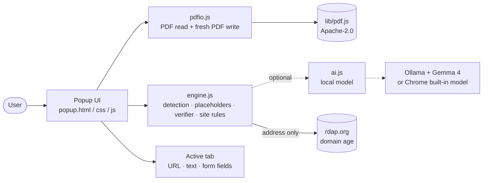
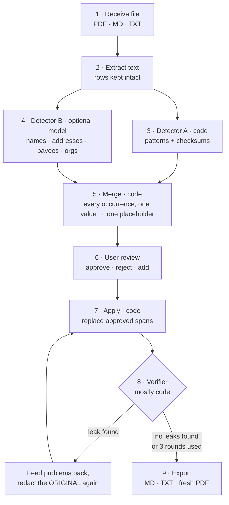
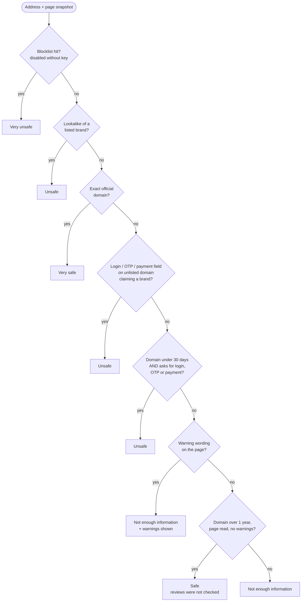

<div align="center">

# 🛡️ Bharosa

### Redact before you share. Verify before you click.

**A local-first, open-source Chrome extension that does two everyday jobs on your own device:**
**it strips private data out of documents, and it checks whether a website is genuine, showing the evidence.**


[Why Bharosa](#-why-bharosa) · [Two modules](#-the-two-modules) · [How it works](#-how-it-works) · [Install](#-install-and-run) · [Limits](#-honest-limits) · [Roadmap](#-roadmap) · [Team](#-team)

</div>

---

<!-- SLIDE 1 · TITLE: Bharosa · tagline · team · event -->

## 📌 At a glance

| | |
|---|---|
| **What it is** | One Chrome extension (Manifest V3), two equal modules |
| **Module A** | **Redact**: text PDF, Markdown or TXT in → redacted `.md`, `.txt` or fresh `.pdf` out. Amounts and dates stay; people, accounts, IDs and addresses go |
| **Module B** | **Check site**: reads the page you are on, compares the address to known brands, checks domain age and page content, shows the evidence for every result |
| **Runs where** | Entirely inside the browser. No server, no token, no terminal commands |
| **AI** | Optional. If a local open model is present (Gemma 4 through Ollama), it also finds names and addresses that patterns miss. Without it, everything still works in pattern mode |
| **What leaves the device** | Only the site address, for a domain-registration lookup (`rdap.org`). Document text and page content never leave |
| **Principle** | **Code decides, AI judges.** The model returns lists. Code does every replacement and every verdict |

---

<!-- SLIDE 2 · PROBLEM -->

## 🎯 Why Bharosa

Two moments, same worry: *"Is this safe?"*

| Moment | The risk | What people do today |
|---|---|---|
| You must paste a **bank statement or similar document** into an AI or cloud tool | It contains names, account numbers, IDs, addresses | Paste it anyway, or blur it by hand and miss things |
| You land on, or are sent, a **link to a site** | It may be a lookalike, a fake store, or a brand-new scam | Guess, or trust a bare "trust score" with no reasons |

**Bharosa answers both at the moment they matter, on your device, with evidence you can read.**

---

<!-- SLIDE 3 · SOLUTION OVERVIEW -->

## 🧩 The two modules

Both modules carry equal weight.

|  | **Module A · Redact before you share** | **Module B · Verify before you click** |
|---|---|---|
| **Input** | Text-based PDF, Markdown or TXT (password-protected PDFs supported) | The current tab (default) or a pasted link |
| **Output** | A redacted file that is still useful to read | A category with a one-line reason and a details section |
| **Code does** | Pattern and checksum detection, finding every occurrence, placeholders, replacing text, verifying, exporting | Address and lookalike checks, domain age, page-content signals, evidence log, category rules |
| **AI does (optional)** | Finds names, addresses, payees and organisations that patterns miss | Not used for the verdict |
| **Trust signal** | "No leaks found by our checks" | "Risk assessment, not a guarantee" |

---

<!-- SLIDE 4 · DESIGN PRINCIPLES -->

## 🧭 Design principles

1. **Local-first.** Documents and page content are processed inside the extension. The honest claim is *"your documents and page content never leave your device"*, not *"nothing ever touches the network"*.
2. **Code decides, AI judges.** AI handles soft judgments (is this a person's name?). Code handles everything that must be exact: matching, counting, replacing, thresholds, exporting.
3. **The AI never rewrites the document.** The model only returns a list of items found. This stops it from altering amounts and stops hidden instructions inside a document from changing the output.
4. **Evidence over scores.** Every verdict shows what was checked, what was found, where it came from, and what could not be checked.
5. **Honest claims.** "Safe to share" and "no warnings found", never "guaranteed private" or "guaranteed safe".
6. **Asymmetry in site checks.** One credible serious red flag can lower a category. Positive signals can never cancel it.
7. **Nothing is stored.** Files and page content live in memory only. The only file written is the redacted output you choose to download.
8. **Failures are never "clean".** A timed-out or failed check is shown as *could not check*.

---

<!-- SLIDE 5 · ARCHITECTURE -->

## 🏗️ How it works

### Architecture

The first build used a Python server on localhost plus a pasted token. It worked but could not ship: every user would have needed Python and terminal commands. The whole pipeline was ported to JavaScript inside the extension.



| Component | Responsibility |
|---|---|
| `popup.html / .css / .js` | Home screen, redact flow, site check screen, review UI, downloads |
| `engine.js` | Detectors, merge, placeholders, verifier loop, site checks, official-domain list, category rules |
| `pdfio.js` | Read text from PDFs (row-preserving), write a fresh PDF with no metadata |
| `ai.js` | Optional on-device model client. Detects what is available and falls back to pattern mode |
| `lib/` | Bundled `pdf.js` (Apache-2.0) |

---

<!-- SLIDE 6 · MODULE A FLOW -->

## 📄 Module A · Redact before you share

> **Goal:** make a private document safe to hand to any AI or cloud service while keeping it *useful*. Amounts, dates and structure survive.



### What is detected

| Category | Found by | Placeholder |
|---|---|---|
| Card numbers | Code, Luhn check | `[CARD_n]` |
| Aadhaar | Code, Verhoeff checksum | `[ID_n]` |
| PAN, IFSC, GSTIN, voter ID, vehicle number, passport, PIN | Code, format rules | `[ID_n]` |
| Bank account numbers (labelled) | Code | `[ACCOUNT_n]` |
| Phone numbers, email addresses, UPI IDs | Code | `[PHONE_n]` `[EMAIL_n]` `[UPI_n]` |
| Dates of birth (labelled) | Code | `[DOB_n]` |
| Names after labels, in UPI narrations, after "paid to" / "received from" | Code | `[PERSON_n]` |
| Names, addresses, payees, organisations in free text | Optional local model | `[PERSON_n]` `[ADDRESS_n]` `[ORG_n]` |
| Businesses (for example *Sharma Jewellers*) | Kept by default; user can override | not replaced |

### What stays

Amounts, dates, transaction order, table structure and merchants you choose to keep. This is the differentiator: **redaction that does not destroy usefulness** for whoever reads the result next.

### Why the verifier is mostly code

A verifier built from the same model as the redactor tends to miss the same things. So the gatekeepers are deterministic:

| Check | Done by |
|---|---|
| Exact-match: no approved original value appears anywhere in the output (case and spacing variants included) | Code |
| Re-scan: fixed-format rules run again on the redacted text | Code |
| Amount and date integrity: figures unchanged from the original | Code |
| Placeholder consistency: one placeholder maps to one value, none broken or doubled | Code |
| Independent name sweep: advisory, never a pass or fail | Code |
| Second read of the redacted text only (optional) | Local model |

If anything fails, leaked values are added, the model gets the specific problem list, and redaction is applied to the **original** again. The loop is **capped at 3 rounds**. Whatever remains is shown to the user, highlighted. The tool never passes silently.

### Safe export

| Format | How |
|---|---|
| Markdown / TXT | Redacted text with placeholders; tables kept as Markdown tables |
| PDF | A **fresh** PDF written from the redacted text. Black boxes are never drawn over the original, because text under a box stays copyable and metadata survives |

Every export strips metadata, uses the neutral filename `redacted-document`, and re-runs the exact-match check on the output. **Export is blocked if an approved value is still present.**

---

<!-- SLIDE 7 · MODULE A DETAILS: PROBLEMS SOLVED -->

### Problems found and fixed while building Module A

Found by running a realistic bank statement with synthetic planted identifiers and reading the output line by line.

| What went wrong | Fix |
|---|---|
| UPI handle swallowed the payee name | Handle pattern allows only letters, digits and dots |
| Names merged with the next field across a hyphen | Hyphen removed from the name pattern |
| A 12-digit transaction reference hidden as an Aadhaar number | Aadhaar rejected inside slash- or hyphen-delimited narrations |
| A merchant treated as a person because of a shared surname | About 50 business words mark an item as a business, kept by default |
| "Quarterly Revenue Report" flagged as a name | Larger common-word list; the sweep is advisory only |
| Label words absorbed into names (`Rahul Sharma Customer ID`), titles kept | `clean_name` trims labels and Mr / Mrs / Dr |
| Multi-line addresses half redacted | Indented continuation lines are included |
| A bare first name or surname left visible elsewhere | Alias pass hides it too, unless the word is common or ambiguous |
| Same person, different placeholders | One placeholder per distinct value, case and spacing folded |
| Model could alter amounts or obey hidden instructions | Model returns a list only; code does all replacing |

### PDF handling

| Challenge | Solution |
|---|---|
| Extensions cannot read PDFs on their own | Bundled `pdf.js` (Apache-2.0), fully offline |
| Bank statements are tables | Text grouped by line position, columns rebuilt from horizontal position |
| Password-protected statements | Popup asks for the password, used in memory only, never stored |
| Scanned PDFs (invisible OCR layer can survive redaction) | Rejected with a clear message. Not supported by design |
| Rupee sign missing from standard PDF fonts | Written as `Rs.` |

---

<!-- SLIDE 8 · MODULE B FLOW -->

## 🌐 Module B · Verify before you click

> **Goal:** say whether a site looks genuine and **show the evidence**. It must handle sites that imitate a real brand and brand-new scam sites that imitate nothing.

### Two input modes

| Mode | What runs | Confidence |
|---|---|---|
| **Check this page** (default) | The extension reads the live page you see: URL, title, text, form fields | Strongest. The page cannot hide behind cloaking, because you are looking at the same page |
| **Paste a link** | Address-only checks. The UI says *"checked the address only; page not viewed"* | Lower. Fetching the page would contact the scam server and may be shown a harmless page |

### Evidence checks (every result is logged, including failures)

| # | Check | What it does |
|---|---|---|
| 1 | Official-domain list | Exact match against a registry of 15 sample brands. Match on the registered domain, never "contains" |
| 2 | Lookalike check | Normalises look-alike characters (0→o, 1→l, Cyrillic, rn→m, vv→w), flags hyphenation, brand-in-hostname, and domains one edit away from a brand |
| 3 | Domain age | Registration date via `rdap.org`. One factor, never alone |
| 4 | Page content | Password, OTP and payment fields; which brand the page claims; urgency wording; UPI or chat payment instructions |
| 5 | Blocklist | Wired in, disabled by default (needs an API key and attribution) |

### How the category is decided

The category comes from **fixed rules in code**, never from a model's opinion. First match wins:



### The categories

| Category | Plain meaning | Never means |
|---|---|---|
| **Very unsafe** | Strong evidence of fraud, such as a blocklist hit | |
| **Unsafe** | Credible warning signs found | |
| **Not enough information** | Too little evidence to judge | Not safe, and not unsafe |
| **Safe** | No warnings found | Not "guaranteed safe" |
| **Very safe** | Exact match with the official domain list | Not "guaranteed safe" |

Every category has a details section. The headline is never a percentage bar, because that would suggest more precision than the checks have. A login form alone is **not** suspicious; the signal is *login form + unlisted domain + claimed brand*. "No login form" never implies safe.

### Problems found and fixed while building Module B

| Problem | Fix |
|---|---|
| Blog with a "Sign in with Google" button flagged as impersonating Google | A brand counts as claimed only in the page title or first 400 characters; "with / using / via Google" ignored |
| Young domains look suspicious, but honest new businesses are young too | Under 30 days is Unsafe only when it also asks for login, OTP or payment |
| Pasted links can be cloaked | Current-tab mode reads what the user sees; pasted-link mode is labelled address-only |
| Official sites hurt by service complaints | Exact official match returns Very safe before any other rule |
| "Safe" read as a guarantee | Wording is "No warnings found" plus "Risk assessment, not a guarantee" |
| Safe Browsing needs a key the user would have to find | Removed from the UI |

---

<!-- SLIDE 9 · PRIVACY -->

## 🔒 Privacy: what stays and what leaves

| Data | Leaves the device? | Notes |
|---|---|---|
| Document contents (Module A) | **No** | Processed in memory inside the extension |
| Page text and form fields (Module B) | **No** | Read by the extension, processed locally |
| Password for a protected PDF | **No** | Used in memory, then discarded |
| Site address | **Yes** → `rdap.org` | Domain-registration lookup only. Disclosed in the UI and must be disclosed in the store listing |
| Anything else | **No** | No analytics, no server, no storage |

**No-storage rules:** no temp files; no logs of document text; the placeholder-to-original mapping lives in memory and is cleared on export, on "Clear session", or when the popup closes; the only thing in your download history is the redacted file you chose.

---

<!-- SLIDE 10 · SCREENS -->

## 🖥️ The interface

Dark teal base, marigold accent, serif display type, and a redaction-bar motif: on the home screen, marigold bars slide over a name and an account number in a sample line with the caption *"Amounts and dates stay. People and numbers go."*

| Screen | What the user sees |
|---|---|
| **Home** | Two large cards: *Redact a document* and *Check a website*. A status chip shows the mode (AI redactor ready, or pattern mode) |
| **Redact · Drop** | Drop area for PDF, MD or TXT; note that scanned PDFs are unsupported; password field if needed |
| **Redact · Review** | Text with findings highlighted. **Each highlight has a text label, not colour alone.** Tap to keep or hide; select text to hide a missed item; findings list with counts and placeholders |
| **Redact · Result** | "No leaks found by our checks" or exactly what remains; risk notes; download as `.md`, `.txt` or `.pdf` |
| **Site · Start** | "Check this page" (default) or "Paste a link" |
| **Site · Result** | Large category label (**label + icon + colour**), one-line reason, "Risk assessment, not a guarantee" |
| **Site · Details** | Each check with source, result and time; a "could not check" list |

> 📸 *Screenshots:* add to `/docs/screenshots/` and reference here.

---

<!-- SLIDE 11 · INSTALL -->

## 🚀 Install and run

No backend. No token. No terminal for end users.

### 1. Load the extension

1. Download or clone this repo.
2. Open `chrome://extensions` and turn on **Developer mode**.
3. Click **Load unpacked** and select the folder that contains `manifest.json`.
4. After any file change, click the reload arrow on the extension card.
5. Pin Bharosa and open it.

### 2. Optional: turn on on-device AI

Without a model, Bharosa runs in **pattern mode**: fully functional, but names and addresses rely on labels and narration formats.

- Install [Ollama](https://ollama.com), pull the model you want to use, and keep it running. The extension detects it automatically; the status chip shows when the AI redactor is ready.
- Alternatively, Chrome's built-in on-device model is detected if available.

### 3. Run the tests

```bash
node tests/t_engine.js     # detection, placeholders, verifier on synthetic corpora
node tests/t_ext.js        # drives the real extension in Chromium
node tests/t_pdf.mjs       # PDF round trip
```

### Repository layout

```text
.
├── manifest.json        # MV3 manifest
├── popup.html / .css / .js
├── engine.js            # detection, verifier loop, site rules
├── pdfio.js             # PDF read + fresh PDF write
├── ai.js                # optional local model client
├── lib/                 # bundled pdf.js + its license
├── icons/
├── tests/               # t_engine.js · t_ext.js · t_pdf.mjs · corpora.js
├── README.md
└── LICENSE
```

---

<!-- SLIDE 12 · TECH STACK + LICENSES -->

## 🧱 Models, tools and licenses

| Component | Role | License |
|---|---|---|
| **Gemma 4** (Google, open weights) | Optional on-device model for names, addresses, payees, organisations | Apache-2.0 as listed on the event page. *Verify against the model card before release* |
| **Ollama** | Local model runtime | MIT |
| Chrome built-in model | Optional alternative to Ollama | Governed by Google's terms; not open-weight. Used only if present |
| **pdf.js** | Reads PDF text inside the extension | Apache-2.0 (license bundled in `lib/`) |
| Built-in PDF writer | Writes fresh, metadata-free PDFs | Own code, project license |
| `rdap.org` | Domain-registration lookup | Public service; address is sent |

> The project license (Apache-2.0 or MIT) is declared in [`LICENSE`](./LICENSE). Any model or tool added later must be listed here with its license.

---

<!-- SLIDE 13 · TESTING -->

## ✅ Testing

All test data is **synthetic**. No real Aadhaar, PAN or account numbers were ever used.

| Test | Result |
|---|---|
| JavaScript vs Python reference on four documents (simple statement, HDFC-style layout, customer letter, clean report) | Identical placeholders and identical redacted text |
| Planted identifiers (names, accounts, phone, email, PAN, IFSC, passport, policy and vehicle numbers, PIN) | All hidden |
| Clean report with nothing sensitive | Left untouched (zero false hits) |
| PDF round trip: PDF in → redact → fresh PDF → extract again | No planted value in output; metadata empty |
| Password-protected PDF | Asked for password, rejected a wrong one, opened with the right one |
| Real Chromium: sample statement, PDF, encrypted PDF, `.md` and `.pdf` downloads | All completed with "No leaks found by our checks" |
| Site check, pasted link | Fake HDFC address → **Unsafe** with evidence; `sbi.co.in` → **Very safe** |
| Site check, simulated page snapshots | Fake bank login with password field → **Unsafe**; "Sign in with Google" blog → no brand claim |
| Failed or blocked lookup | Shown as *could not check*, never clean |

> 📊 *Detection numbers (planted identifiers caught vs missed) to be added from a measured run on the synthetic corpus before release.*

---

<!-- SLIDE 14 · HONEST LIMITS -->

## ⚠️ Honest limits

We would rather tell you than have you find out.

### What it cannot do

| Area | Limit |
|---|---|
| Redaction | Best effort. The claim is **"No leaks found by our checks"**, never "guaranteed private" |
| Names and addresses | In pattern mode they depend on labels and narration formats. With a small local model some are still missed or mislabelled, which is why the **review step** exists |
| Re-identification | A rare amount or an employer name can still identify someone. Shown as a risk note, not auto-redacted |
| Files | Scanned PDFs and DOCX unsupported. Complex layouts may lose some column fidelity |
| PDF output | Uses a standard font; some characters are mapped to safe equivalents |
| Site check | A risk assessment, not a guarantee. Only 15 brands are in the official list |
| Hacked old sites | A clean, aged domain that was hacked passes most checks; only page content can catch it |
| No-login scams | A fake shop taking UPI payments has no password field. "No login form" never implies safe |
| Reviews and social comments | **Not checked.** Listed under "could not check" |
| Certificates | Not readable from a Manifest V3 extension. Listed under "could not check" |
| Non-English pages | A model may judge other languages worse; PDFs and browser-internal pages are not covered |
| Lookups | Looking up an address reveals it to the lookup service |

### Not yet verified in the real environment

- The **AI path** (Ollama or Chrome's model): no model was available in the build environment. Pattern mode was fully tested.
- **Live `rdap.org` lookups**: the build sandbox blocked them. On failure the extension shows *could not check* and continues.
- **Current-tab page reading in a live browser**: logic tested on simulated snapshots; the live tab permission was not exercised.

---

<!-- SLIDE 15 · ROADMAP -->

## 🗺️ Roadmap

| Horizon | Item |
|---|---|
| **Next** | Measure and publish detection numbers on the synthetic corpus; exercise the AI path with the chosen Gemma 4 build; live-test current-tab reading and RDAP |
| **Site check** | Grow the official-domain registry (banks, UPI apps, e-commerce, telecoms, government); soften "brand in hostname" to *Looks like X* unless a login, OTP or payment field is also present; fuller Unicode confusable and punycode handling; tune the 30-day and 1-year thresholds on real sites |
| **Evidence pipeline** | Independent comment pipeline (collector, verifier and reviewer agents) with an **evidence log the agents cannot edit** and a fact validator that deletes any sentence not matching the log; fraud allegations as the only input that can pull a site toward Unsafe; ownership checks (company and GST registries, regulator lists) |
| **Redaction** | Strict mode (also redact rare amounts and employer names); DOCX; a "redo with feedback" screen between verifier rounds |
| **Distribution** | Chrome Web Store listing with the `rdap.org` disclosure; optional in-browser model through WebGPU for a zero-install AI path |

---

<!-- SLIDE 16 · HOW IT MAPS TO THE EVENT -->

## 🏆 Built for Hacktoberfest Hack Day

**Hacktoberfest Hack Day · Pune · 24 to 25 Oct 2026 · Main Track: Best Open-Source AI Project**

| What judges look for | Where Bharosa shows it |
|---|---|
| **Technology and open-source AI use** | Local open model (Gemma 4) as an optional judgment layer; layered design where deterministic code does everything that must be exact; open license; named tools and licenses |
| **Completion with a working demo** | Both modules work end to end: PDF in, redacted PDF out; lookalike bank login flagged, genuine site not |
| **Idea** | Two everyday risk moments; redaction that keeps usefulness; evidence instead of a score |
| **Understanding of implementation** | Why code decides and AI judges; why the model never rewrites the document; why the verifier is mostly code |
| **Design and usability** | The review step, labels not colour-only, an evidence panel, careful wording |
| **Presentation and Q&A** | The honest-limits section above |

### Demo flow

1. One sentence on each problem.
2. **Redact:** drop a synthetic bank statement → highlighted findings → approve → export → paste into an AI to show it is still usable.
3. A planted leak caught by the verifier and fixed in the loop.
4. **Check site:** open a lookalike bank login → category and evidence panel.
5. Open the genuine site → not flagged.
6. Close on what it cannot do and how that was handled.

---

<!-- SLIDE 17 · TEAM -->

## 👥 Team

Three members; every member can explain every part.

| Role | Owns | Main files |
|---|---|---|
| **A · Redaction pipeline** | Detection, placeholders, verifier loop, PDF read and write | `engine.js` (redaction), `pdfio.js`, `lib/`, `tests/t_engine.js`, `tests/corpora.js` |
| **B · Extension shell and site check** | Manifest, page reader, lookups, evidence log, category rules, optional AI | `manifest.json`, `engine.js` (site check), `ai.js`, `tests/t_ext.js`, `tests/t_pdf.mjs` |
| **C · UI, docs and demo** | Screens, README, license, icons, demo script | `popup.html`, `popup.css`, `popup.js`, `icons/`, `README.md`, `LICENSE` |

<!-- Replace with names and GitHub handles before publishing -->
| Member | GitHub |
|---|---|
| _Member A_ | `@handle` |
| _Member B_ | `@handle` |
| _Member C_ | `@handle` |

---

## 🤝 Contributing

Issues and pull requests are welcome. Please use only **synthetic** data in tests and examples, and keep claims honest: if a change makes the tool sound more certain than the checks justify, reword it.

## 📄 License

See [`LICENSE`](./LICENSE).

## 🙏 Acknowledgements

Domain lookups via [rdap.org](https://rdap.org). PDF reading via [pdf.js](https://github.com/mozilla/pdf.js). Local models via [Ollama](https://ollama.com). If Google Safe Browsing is ever enabled, its required warning wording and attribution to Google will be shown in the UI.

<div align="center">

**Bharosa** means *trust*. We tried to earn it by showing our work.

</div>
